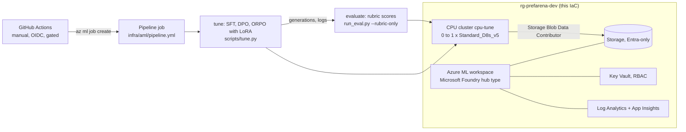

# Fine-tuning on Azure ML / Microsoft Foundry (written, not run)

Nothing here has been deployed. The IaC is checked in CI (`terraform validate` and `test` with mocked
providers, `tflint`, `checkov`, `bicep build`), and the deploy workflow is switched off.

## Target design

The pipeline runs the same code as the local run: `scripts/tune.py` downloads the open 135M model,
trains with LoRA on CPU and writes answers; the evaluate step scores them with the rubric. The judge
and the embedding reward model stay local (they need llama.cpp and sentence-transformers).

| Resource | Terraform | Bicep |
|---|---|---|
| Log Analytics + Application Insights | `azurerm_*` | same ARM types |
| Storage (TLS 1.2, no shared keys, no public blobs) | `azurerm_storage_account` | `Microsoft.Storage/storageAccounts` |
| Key Vault (RBAC, purge protection) | `azurerm_key_vault` | `Microsoft.KeyVault/vaults` |
| Azure ML workspace (identity access to storage) | `azapi_resource` (2025-06-01) | `workspaces@2025-06-01` |
| CPU cluster: min 0 nodes, idle 2 minutes, no SSH, local auth off | `azapi_resource` (`computes@2025-06-01`) | `computes@2025-06-01` |
| Cluster identity -> Storage Blob Data Contributor on the workspace storage | `azurerm_role_assignment` | `roleAssignments` |
| Diagnostic settings (workspace, Key Vault) | `azurerm_monitor_diagnostic_setting` | `diagnosticSettings` |

## Cost before anyone says yes

Prices from the Azure Retail Prices API, pay-as-you-go, eastus2, checked 2026-11-09:

| Item | Price | One pipeline run |
|---|---|---|
| Cluster node, Standard_D8s_v5 Linux (8 vCPU, 32 GB) | $0.384 per hour | under $1 for a run of about an hour |

The cluster idles at zero nodes, so there is no always-on compute charge. Storage, Log Analytics and
Key Vault add small monthly charges. A bigger model or a managed fine-tuning job in Microsoft Foundry
(where available for the chosen model) is billed separately and is not in this IaC. Delete the
resource group to stop all charges. Check current prices and get approval before enabling the workflow.

## One-time setup (only if approved)

1. Entra app registration with a federated credential for this repo's `dev` environment.
2. Contributor on one resource group.
3. Repository variables `AZURE_CLIENT_ID`, `AZURE_TENANT_ID`, `AZURE_SUBSCRIPTION_ID`.
4. A required reviewer on the `dev` environment.
5. `DEPLOY_ENABLED=true`, then run **deploy** by hand.

## Planned, not built

A registered model and a managed online endpoint for the tuned adapter, a managed fine-tuning job in
Microsoft Foundry for a larger model, private networking, and comparing cloud and local results.
