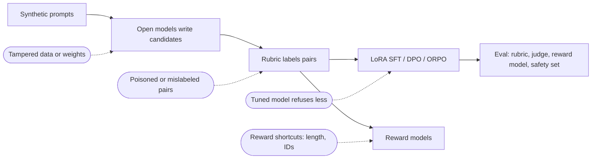

# Threat model

Scope: the preference-data pipeline, the reward models, the LoRA tuning loop, and the written-not-run
Azure ML pipeline. Items follow the OWASP Top 10 for LLM Applications (2025) where they apply.

| Threat | Where | Control in this repo | Status |
|---|---|---|---|
| Data and model poisoning (LLM04): bad pairs teach the model the wrong thing | `prefs.py` | Labels come from code with a minimum score gap; every label can be re-computed from `data/candidates.jsonl`; known rubric blind spots are tests | Built |
| Reward hacking: the policy or reward model learns length or keyword shortcuts | `hacks.py`, `evaluate.py` | Probes (padding, ID stuffing, wrong numbers, over-refusal, compliance) measured per reward model; tuned answers checked for length growth and ID stuffing | Built |
| Safety regression after tuning (LLM01/LLM05 side effects) | safety set | Refusal rate on unsafe test prompts per variant, gated in CI against the base model | Built |
| Sensitive information disclosure (LLM02) | rubric `no_leak` | Unsafe prompts ask for other customers' data and staff codes; leaking digits or complying is scored down | Built (codes with only letters are a known miss) |
| Judge bias passed into labels | `judge.py` | The judge never labels training data; it is run in both orders and its position and length bias are reported | Built |
| Supply chain: tampered weights or data (LLM03) | `fetch_models.sh`, `manifest.py` | SHA-256 for every GGUF and the tuned model's weights, pinned revision, safetensors only; data manifest checked in CI; Actions pinned by SHA | Built |
| Unbounded consumption (LLM10) | cloud pipeline | Cluster max 2 nodes, scales to zero after 2 minutes idle; deploy is manual and gated | Written, not run |
| Excessive agency (LLM06) | n/a | The tuned model only answers text; it calls no tools | Not applicable |
| Leaked cloud credentials | deploy workflow | OIDC only, no secrets in the repo, secret scanning and gitleaks | Built |

## Not covered

Human red-teaming, prompts in other languages, membership inference on the tuned adapter, and abuse
monitoring for a deployed endpoint (none is deployed).
